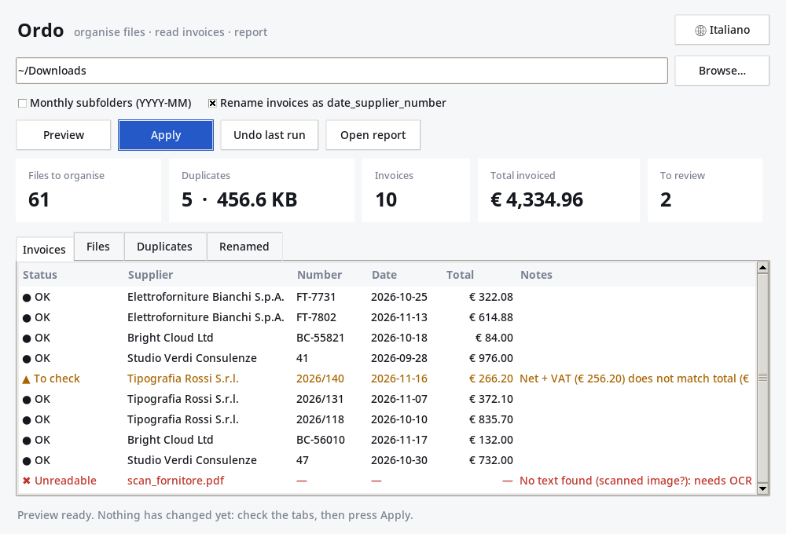

# Ordo — Python automation

**Ordo** tidies a messy folder, reads supplier invoices from PDF files and writes a report.
Personal demo project by [Cristian Casciani](https://cristiancasciani.github.io/).

**[See it in action →](https://cristiancasciani.github.io/python-automation/)** (replayed terminal run, sample report and Excel file)



## What it does

| | |
|---|---|
| **Organise** | Sorts files into `Images/`, `Documents/`, `Spreadsheets/`, … (optionally `YYYY-MM` subfolders). Duplicates are found by content (SHA-256) and set aside, keeping the oldest copy. |
| **Read invoices** | Finds invoices among the PDFs and extracts supplier, number, date, VAT ID, net, VAT and total. Works with Italian and English layouts. Checks that net + VAT = total and flags scans without text. |
| **Rename** | Renames invoices as `2026-10-25_supplier_number.pdf`, or any files with a pattern: `{date}_{name}`, `photo_{n:03}`, regex find/replace, lowercase, clean names. |
| **Report** | A self-contained HTML page (charts, tables) and an Excel workbook with live totals. |
| **Italian / English** | Interface, reports and folder names in either language: `ordo --lang it …`, a switch in the window, or automatic from `$LANG`. |
| **Safe** | Nothing changes without `--apply`; every run is journaled and `ordo undo` puts every file back. |

## Use it

```bash
python3 -m venv .venv && .venv/bin/pip install -e .

ordo run ~/Downloads                 # preview everything, write a preview report
ordo run ~/Downloads --apply --open  # do it and open the report
ordo undo ~/Downloads                # put everything back

ordo organize ~/Downloads --by-date --apply
ordo rename ~/Pictures/trip -p "rome_{n:03}" --ext jpg --sort date --apply
ordo invoices ~/Invoices --xlsx invoices.xlsx
ordo gui                             # the window (Tkinter)
```

Try it on fake data first:

```bash
.venv/bin/pip install -e ".[dev]"
python scripts/make_demo.py          # creates demo/Downloads with 61 messy files and 10 invoices
ordo run demo/Downloads --open
```

## How it is built

```
ordo/
  organize.py   categories, duplicate detection (size, then SHA-256), move plan
  invoices.py   PDF text (pypdf) + regex extraction, amount/date parsing, checks
  rename.py     pattern rename, conflict detection, safe ordering for chained renames
  journal.py    apply operations and undo them
  pipeline.py   the full job used by both interfaces
  report.py     HTML (inline SVG charts) and Excel (openpyxl) reports
  cli.py        command line (argparse + rich)
  gui.py        window (Tkinter, work in a background thread)
  i18n.py       Italian and English texts
scripts/        demo data generator, showcase builder
tests/          pytest suite (18 tests)
docs/           GitHub Pages showcase
```

Dependencies: `pypdf`, `openpyxl`, `rich` (Tkinter comes with Python; on Debian/Ubuntu install `python3-tk`).

## Limits

Scanned invoices (images without a text layer) are detected and flagged, not read: that would need OCR.
Extraction is rule-based, so very unusual layouts may need a new pattern in `invoices.py`.

---
The companies and invoices in the demo are fictional.
